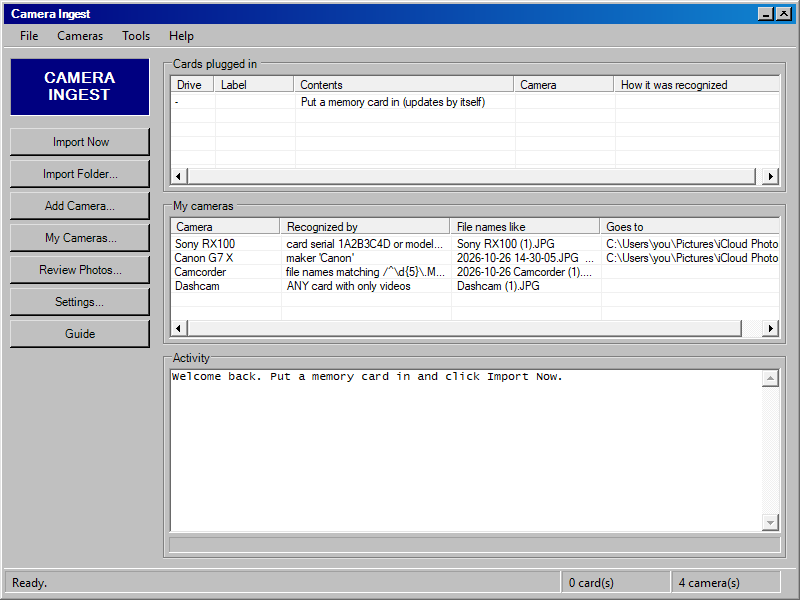
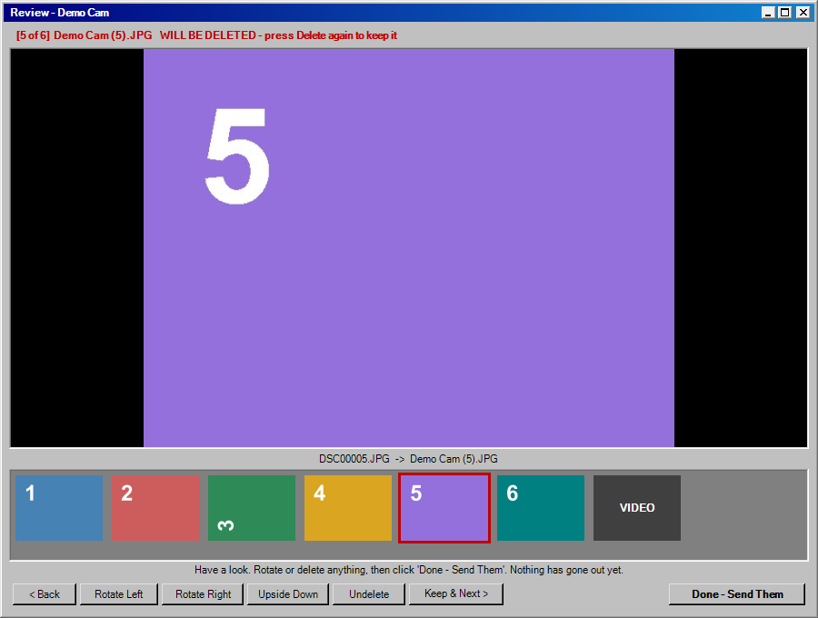

# Camera Ingest

**A memory-card importer for people with more than one camera.** Put a card in,
and it works out *which camera that card came from*, then imports it by that
camera's own rules: numbered names that never clash, real capture dates (or
today's date for a camera whose clock is wrong), hard-to-play video formats
turned into MP4, RAW files kept on your PC, and nothing ever imported twice.

Built for Windows as a small point-and-click app in the style of Windows 98:
no config files to edit and nothing to install first.





**Full guide, including iCloud setup:** open [`How to use.html`](How%20to%20use.html)
(or **Help → Guide** in the window).

## Why this exists

Most importers do one thing: copy a card into dated folders. That breaks down
once you're bringing in cards from several cameras, say a compact, a
mirrorless, a dashcam and a camcorder:

- many cameras name files the same way (`DSC00001.JPG`, `IMG_0001.JPG`), so imports collide
- a camera whose clock got reset stamps everything years in the past
- AVI / MPG / MTS / ASF videos don't play in iCloud or Google Photos
- RAW files bloat a cloud library
- photo clouds upload a file **the instant it lands** in the synced folder and
  may never pick up edits, so rotating sideways shots afterwards is too late
- putting the same card in twice gives you two of everything

Camera Ingest handles each of those per camera.

## Getting started

1. Download and unzip it anywhere (Desktop, Documents, a USB drive).
2. Double-click **`Camera Ingest.bat`**, then click **Set Up**. The welcome box
   asks where to keep the library and offers to install the free video tool,
   then opens **Add Camera** for your first camera. **File → Create Desktop
   Shortcut** gives you a one-click icon.
3. **Add Camera** is a tabbed settings box: **Use Card** learns the plugged-in
   card, a **preset** fills in sensible settings, and you choose where files go
   and how they're named (running count, date and time, the camera's names, or
   your own pattern), with a live example as you choose. It then offers a
   **practice run** that copies the card into a practice folder without
   touching the card.

After that: put a card in, the window shows which camera it belongs to, and you
click **Import Now**. Cameras you've set to start without asking import with no
questions at all.

Prefer the keyboard? **`Text Menus.bat`** (or **Tools → Text Menus**) does everything from numbered text menus, and
**`Import Now.bat`** is a one-click import with no window.

## Features

| | |
|---|---|
| **Recognizes cards** by card serial number, camera model or maker in the photos, file-name style, a fixed drive letter, or catch-alls ("any card with only videos") | Specific rules always beat catch-alls |
| **Presets** for Sony, Canon, Nikon, Fujifilm, Panasonic, Olympus and Kodak cameras, dashcams, camcorders, wrong-clock cameras, plain archiving, and more | [Make your own](docs/PRESETS.md) and share them as one JSON file |
| **Never imports twice**: SHA256 fingerprint ledger per camera | Survives renames and months between imports |
| **Safe deletes**: off by default; when on, only after the copy's fingerprint matches | Never formats anything |
| **Watch it import**: a photo window pops up showing each photo as it comes off the card (big preview + growing filmstrip), then turns into the **review**: rotate, upside-down or delete with buttons or keys, before anything is sent | Photos wait in a local `Incoming` folder until you click Done; an interrupted run is picked up next time and never uploaded blind |
| **Video → MP4** for AVI, MPG, MTS, ASF and similar, with HandBrakeCLI or ffmpeg; capture date written *inside* the MP4 so photo timelines place it right | Original kept locally |
| **RAW stays local**: the destination gets the camera's own JPG (RAW+JPEG) or a rendered one (via rawpy) | Or send RAW as-is |
| **Wrong-clock fix**: today's date written *inside* JPEGs (byte-for-byte, no re-compression) and MP4/MOV, which is what iCloud sorts by | Untouched original kept |
| **Any destination**: a library folder, iCloud Photos, OneDrive, Google Drive, a NAS | iCloud folder auto-detected |
| **Per-camera file naming**: running count, date and time taken, date + count, the camera's own names, or a custom pattern like `{year}-{month} {name} {n:4}`, with a preview | Counts carry on across imports |
| **Hands-off mode**: a camera can start without asking and skip the review, so plugging its card in is all it takes | Per camera |
| **Photo hook** (advanced): run your own command on every JPG before it goes out | Untouched copy kept |

## What's optional

Nothing is required beyond Windows 10/11 (it uses the built-in Windows
PowerShell 5.1). The menus offer to install these through Windows' own
`winget`, from their official sources:

- **ffmpeg** or **HandBrakeCLI**: converting AVI/MPG-style videos. Without
  them, those videos are copied as-is.
- **Python + rawpy**: rendering RAW-only shots to JPG. Without them, RAW files
  are kept but no JPG is made (RAW+JPEG cameras still work).

These tools are **not bundled**. They have their own licenses (GPL/LGPL).

## Limits (honest list)

- **Windows only.**
- **Needs a drive letter.** Cameras plugged in by USB that show up as a
  "portable device" (MTP/PTP) aren't seen. Use a card reader.
- **Brand presets are best-effort.** They match the standard maker/model
  strings those brands write into EXIF, and are tested against synthetic files,
  not every real camera. If one misses your camera, use Custom setup, which
  learns from your actual card.
- A card's serial number changes if you format it **in a computer**
  (formatting in the camera usually keeps it). Re-learn it under
  *My cameras → Recognition rules*.
- Wi-Fi cameras and phones aren't sources. Phones are better served by their own photo apps.

## Folder layout

```
Camera Ingest\
  Camera Ingest.bat      the window (start here)
  Text Menus.bat         the same things as numbered text menus
  Import Now.bat         one-click scan + import, no window
  How to use.html        the user guide
  presets\               ready-made camera setups (add your own)
  src\                   the program (PowerShell + one Python helper): App.ps1 is the main window,
                         Viewer.ps1 the photo window, Retro.ps1 the shared Windows 98 look
  tests\                 unit tests, stress tests, scripted menu walkthrough
  data\config.json       your settings (created on first run)

Library\ (you choose where; default Pictures\Camera Ingest)
  <Camera name>\
    Media\                 finished files (unless you picked another destination)
    Incoming\              photos waiting for review before they go out
    Working\               videos being converted / re-dated before they go out (empty when idle)
    Converted Originals\   original AVI/MPG/MTS files
    RAW Originals\         RAW files
    Unprocessed Originals\ untouched copies of anything re-dated or patched
    imported_media.csv     fingerprint ledger (what was imported, as what, when)
```

## Command line

```
powershell -ExecutionPolicy Bypass -File src\Import.ps1                  # scan + import
powershell -ExecutionPolicy Bypass -File src\Import.ps1 -Yes             # no questions (scheduled task)
powershell -ExecutionPolicy Bypass -File src\Import.ps1 -Source D:\Backup -Camera "Sony RX100" -Practice
```

## Tests

```
powershell -ExecutionPolicy Bypass -File tests\Run-Tests.ps1
powershell -ExecutionPolicy Bypass -File tests\Stress-Tests.ps1
```

Run them one at a time: both import, and only one import may run at once.

**Unit tests** build fake cards (JPEGs with real EXIF, a RAW+JPEG pair, an AVI,
junk system folders) in a temp folder and cover recognition, presets,
numbering, dedup, keep-names clashes, wrong-clock dates, practice runs,
interrupted-run recovery, video conversion with embedded dates, review deletes
and the photo hook. EXIF checks need Python + Pillow and video checks need
ffmpeg; without them those checks are reported as skipped.
`tests\Drive-Menu.ps1` runs the real menus with scripted answers, and
`tests\Viewer-Demo.ps1` drives the photo window (a live import, then a scripted
review that turns and deletes photos) and checks the files afterwards.

**Stress tests** ask one question over and over: *can it ever lose a photo?*
After every scenario they check that every file that was on the card still
exists byte-for-byte (on the card or in the library) and that no library file
was changed. Scenarios include:
- a 1,500-file card with hostile file names
- injected failures: a failed copy, a corrupted copy, a pulled card, a crash
  before and after logging, a failed send
- two windows at once, reused names, overlapping folders, damaged photos in
  the review, and a lost ledger
- hundreds of randomized fault rounds

Before any of that, they prove the checker catches deliberate damage.

**Not yet tried on real cards in this packaged form.** The engine is a
generalization of import scripts the author has used on real cards from several
cameras; this version has been checked with the suites above.

## License

MIT. See [LICENSE](LICENSE).
